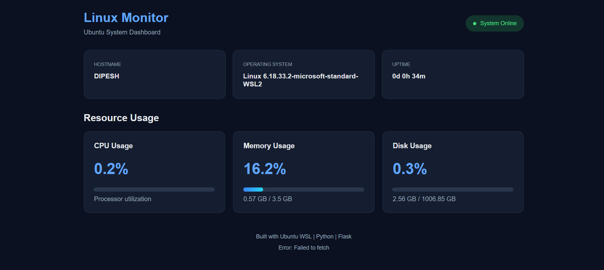

# 🐧 Linux System Monitor Dashboard

A web-based dashboard to monitor Linux system resources in real time.

This project uses Ubuntu WSL, Python, Flask, psutil, HTML, CSS, and JavaScript to display system information and resource usage.

## 🚀 Features

- Displays system hostname.
- Shows operating system information.
- Displays system uptime.
- Monitors CPU usage.
- Monitors RAM usage.
- Monitors disk usage.
- Automatically updates system statistics.
- Provides a dark-themed dashboard.

## 🛠️ Technologies Used

- Ubuntu Linux (WSL)
- Python
- Flask
- psutil
- HTML5
- CSS3
- JavaScript
- Git and GitHub

## 📋 Prerequisites

Install the following tools before running the project:

- Ubuntu on WSL
- Python 3
- pip
- Git

## ⚙️ Installation and Setup

### 1. Clone the Repository

```bash
git clone https://github.com/dipesh3103/linux-system-monitor.git
cd linux-system-monitor
```

### 2. Create a Virtual Environment

```bash
python3 -m venv venv
```

### 3. Activate the Virtual Environment

```bash
source venv/bin/activate
```

### 4. Install Dependencies

```bash
pip install -r requirements.txt
```

### 5. Run the Application

```bash
python3 app.py
```

### 6. Open the Dashboard

Open your browser and visit:

http://localhost:5000

## 📊 System Information Monitored

| Resource | Description |
|---|---|
| CPU | Processor utilization |
| Memory | RAM usage |
| Disk | Disk space utilization |
| Hostname | System hostname |
| Operating System | Linux system information |
| Uptime | Time since the system started |

## 🎯 Learning Objectives

- Learn Linux system administration basics.
- Understand system resource monitoring.
- Practice Python and Flask.
- Learn how a web application displays system information.
- Practice Git and GitHub.

## 📸 Dashboard Preview



## 👨‍💻 Author

Dipesh Chaudhari

## 📄 License

This project is created for learning and educational purposes.
